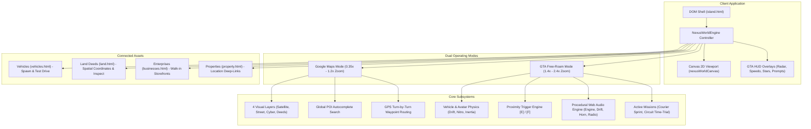
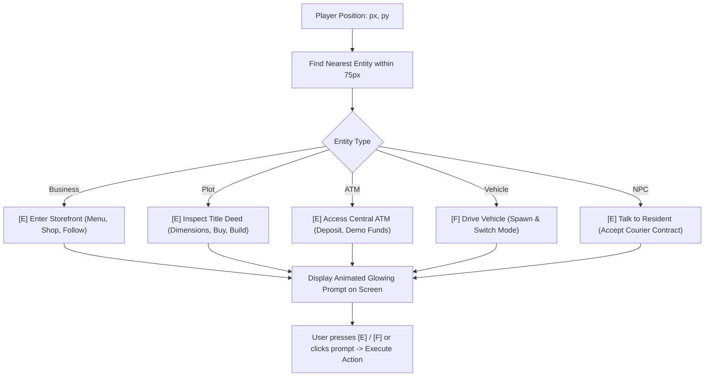

# Nexus Island — Google Maps & GTA Interactive World Engine Specification

> **Technical Architecture & Implementation Reference for the World & Assets Engine (v6)**  
> **Launch Geography**: Abu Dhabi / UAE Archipelago  
> **Runtime Environment**: High-Performance HTML5 Canvas 2D/2.5D with LocalStorage Persistence  

---

## 1. Executive Overview & Design Philosophy

The **Google Maps & GTA Interactive World Engine** transforms the Nexus Island MVP from a traditional listing-based web application into a living, persistent virtual society. By synthesizing **geospatial cartography** (Google Maps style pan, zoom, layers, and search) with **interactive sandbox gameplay** (GTA-style free-roam driving, vehicle physics, contextual `[E]` triggers, radar minimap, and courier contracts), the engine delivers high engagement without external 3D engine overhead.



### Core Design Principles
1. **Zero Download / Zero Plugin Friction**: Runs instantly on standard browsers via pure HTML5 `<canvas>` and vanilla JavaScript.
2. **Deterministic 60 FPS Performance**: Optimized render loop with double-buffering, layered draw passes, and particle cleanup.
3. **Seamless Dual Modality**: Smooth transition between high-level macro planning (Google Maps view) and ground-level avatar exploration (GTA view).
4. **Complete Offline & Static Host Support**: Self-contained within `assets/js/app.js` with full LocalStorage state preservation.

---

## 2. World Coordinate System & Data Topology

The entire archipelago is mapped within a virtual coordinate space of **2,400 × 1,800 virtual pixels**.

```
(0, 0) ──────────────────────────────────────────────────────── (2400, 0)
  │                                                                 │
  │   [Harbor District]                  [Creator District]         │
  │   (500, 520)                         (1640, 440)                │
  │   - Marina Promenade                 - Louvre Crystal Pavilion  │
  │   - Yacht Berths & Roastery          - Saadiyat Ateliers        │
  │         \                                  /                    │
  │          \==== Corniche Grand Blvd ======/                      │
  │                     \            /                              │
  │   [Nature Zone]   [Central Interchange]    [Downtown Core]      │
  │   (380, 1260)           (1150, 950)        (1720, 1020)         │
  │   - Mangrove Reserve         │             - ADGM Apex Tower    │
  │                              │             - Central ATM        │
  │   [Gaming District]          │                                  │
  │   (740, 1180)                │             [Future Zone]        │
  │   - Yas Cyber Arena          │             (1960, 1440)         │
  │   - Grand Prix Circuit       │             - NOVA Quantum Spire │
  │                              │             - eVTOL Skyport      │
  │                     [Residential District]                      │
  │                     (1200, 1420)                                │
  │                     - Palm Sanctuary Lagoon                     │
  │                     - Overwater Majlis Villas                   │
  │                                                                 │
(0, 1800) ──────────────────────────────────────────────────── (2400, 1800)
```

### 2.1 District Biomes & Landmarks
| District ID | Center `(X, Y)` | Radius | Theme Color | Signature Landmark & Focus |
| :--- | :--- | :--- | :--- | :--- |
| `harbor` | `(500, 520)` | `260px` | `#0891b2` (Cyan) | **Marina Grand Promenade**: Waterfront arrival, luxury yachts, cafes. |
| `creator` | `(1640, 440)` | `280px` | `#ea580c` (Amber) | **Louvre Crystal Pavilion**: Saadiyat ateliers, VR stages, NFT galleries. |
| `gaming` | `(740, 1180)` | `290px` | `#7c3aed` (Purple) | **Yas Cyber Arena & Circuit**: Racetrack loop, esports stadiums, arcades. |
| `downtown` | `(1720, 1020)` | `280px` | `#0ea5e9` (Sky) | **ADGM Apex Tower**: Financial headquarters, virtual banks, fintech spires. |
| `residential` | `(1200, 1420)` | `260px` | `#059669` (Emerald) | **Palm Sanctuary Lagoon**: Overwater villas, private beaches, majlis spaces. |
| `nature` | `(380, 1260)` | `240px` | `#16a34a` (Green) | **Eastern Mangrove Reserve**: Eco-tourism boardwalks, desert dune safaris. |
| `future` | `(1960, 1440)` | `250px` | `#6366f1` (Indigo) | **NOVA Quantum Spire**: Masdar clean-tech, AI computing port, eVTOL skyport. |

### 2.2 Arterial Road & Circuit Graph
The road network connects all 7 districts with dedicated lanes, bridge spans over water channels, and the **Yas Grand Prix Racing Circuit**:
* **Corniche Grand Blvd**: Connects Harbor Marina `(380, 520)` through Harbor Core `(520, 520)` to Central Interchange `(1150, 950)`.
* **Saadiyat Causeway**: Suspension bridge over open water from `(840, 560)` to `(1250, 480)` into Creator District `(1640, 440)`.
* **ADGM Tech Spine**: High-speed highway from Central Interchange `(1150, 950)` to Downtown Core `(1720, 1020)` and Future Zone `(1960, 1440)`.
* **Palm Sanctuary Drive**: Scenic boulevard connecting Central Interchange to Residential Lagoon `(1200, 1420)`.
* **Yas Grand Prix Circuit**: Closed-loop oval circuit surrounding `(740, 1180)` with high-contrast racing curbs and rumble strips.

---

## 3. Geospatial Google Maps Engine Specification

### 3.1 Dynamic Multi-Layer Rendering
The engine renders 4 switchable visual styles with instant toggling:

```
[SATELLITE]              [STREET]                 [CYBER (NIGHT)]          [LAND DEEDS]
Natural Azure Gradients  Vector Asphalt Roads     Neon Wireframe Grid      Lot Subdivision Grid
Deep Ocean Waves         Street Shields & Names   Glowing Circuit Edges    Plot IDs (L-101 to L-703)
Sand Beach Fringe        District Boundary Lines  Dark Glass Skyscrapers   Price & Ownership Tags
Lush Biome Vegetation    Clean Transit Cartography Particle Light Streams  Interactive Inspection
```

1. **Satellite Photorealistic Layer**:
   * Multi-stop radial gradient for ocean depths (`#083344` to `#021324`).
   * Sandy buffer rings around district landmasses (`rgba(251, 191, 36, 0.25)`).
   * Lush emerald terrain fills (`#064e3b` to `#065f46`) with district accent highlights.
2. **Street / Cartographic Layer**:
   * Light asphalt roadways (`#334155`) with dashed yellow centerline dividers (`#fbbf24`).
   * Clean dark district fills (`#0c233c`) with sharp administrative boundary borders.
   * High-contrast street name badges and arterial shields.
3. **Cyber Blueprint Layer (Night Mode)**:
   * Deep black oceanic backdrop (`#010309`).
   * Neon purple and cyan circuit roadways (`#1e1b4b` and `#061a33`) with glowing edges.
   * Architectural wireframes and glowing landmark beacons.
4. **Land Deeds Subdivision Layer**:
   * Rectangular real estate parcels (`L-101` through `L-703`) outlined with cyan neon stroke (`#22d3ee`).
   * Semi-transparent fill (`rgba(6, 182, 212, 0.12)`) and monospace lot ID text.

### 3.2 Pan, Zoom & Camera Matrix
Camera transformations are applied dynamically via the Canvas 2D context:
$$\begin{bmatrix} X_{screen} \\ Y_{screen} \end{bmatrix} = \begin{bmatrix} \text{zoom} & 0 \\ 0 & \text{zoom} \end{bmatrix} \begin{bmatrix} X_{world} - \text{cam}_x \\ Y_{world} - \text{cam}_y \end{bmatrix} + \begin{bmatrix} W / 2 \\ H / 2 \end{bmatrix}$$

* **Continuous Pan**: Mouse drag or touch swipe updates camera target with inertia dampening.
* **Proportional Zoom**: Scroll wheel and touch pinch zoom clamped between `0.35x` (full macro archipelago view) and `2.4x` (ground-level detail).
* **Target Smoothing (Lerp)**:
  $$\text{cam}_x \leftarrow \text{cam}_x + (\text{target}_x - \text{cam}_x) \times 0.12$$
  $$\text{cam}_y \leftarrow \text{cam}_y + (\text{target}_y - \text{cam}_y) \times 0.12$$
  $$\text{zoom} \leftarrow \text{zoom} + (\text{target}_{\text{zoom}} - \text{zoom}) \times 0.12$$

### 3.3 Autocomplete Location Search
* Live string search across districts, land plots, storefronts, and vehicles.
* Clicking any result invokes `selectWorldPoi(id)`:
  * Triggers camera `flyTo` animation with target coordinates and zoom level `1.35x`.
  * Computes an animated GPS waypoint line from player coordinates to destination.
  * Plays UI reward sound and flashes success notification toast.

---

## 4. GTA-Style Gameplay & Free-Roam Simulator

### 4.1 Player & Vehicle Physics Model
When `worldEngine.mode === 'drive'`, the camera locks into follow-cam mode and enables vehicle dynamics:

```
                          Forward Accel [W]
                                 ▲
                                 │
           Turn Left [A] ◄───────┼───────► Turn Right [D]
                                 │
                                 ▼
                         Brake / Reverse [S]
                          
       [Space]: Handbrake Drift ───► Tire Skid Marks + Screech Audio
       [Shift]: Nitro Boost     ───► 1.6x Speed + Exhaust Cyan Flames
```

#### Mathematical Physics Formulation
1. **Acceleration & Top Speed**:
   $$v_{\text{max}} = 8 + \left(\frac{\text{stat}_{\text{speed}}}{10}\right) \times (\text{nitro} \ ? \ 1.6 : 1.0)$$
   $$v \leftarrow \min(v_{\text{max}}, v + a \times (\text{nitro} \ ? \ 2.0 : 1.0))$$
2. **Friction & Braking**:
   $$v \leftarrow v \times 0.94 \quad (\text{natural rolling friction})$$
   $$v \leftarrow \max(-0.4 \times v_{\text{max}}, v - 0.8 \times a) \quad (\text{reverse brake})$$
3. **Speed-Sensitive Steering**:
   $$\Delta \theta = 0.05 \times \left(\frac{v}{v_{\text{max}}}\right)$$
4. **Drift Mechanics**:
   Holding `Space` while turning initiates lateral slip:
   $$v \leftarrow v \times 0.97$$
   Spawns skid mark decals at rear tire coordinates:
   $$(x_{\text{tire}}, y_{\text{tire}}) = (p_x \pm 6\cos(\theta + \pi/2), p_y \pm 6\sin(\theta + \pi/2))$$
5. **Nitro Fuel Regeneration**:
   Consumes `0.4%` per tick when accelerating with `Shift`; passively regenerates at `0.15%` per tick when disengaged.

### 4.2 Proximity Trigger Engine (`[E]` / `[F]`)
Every frame, the engine scans all interactable world entities within an interaction radius of **75px**:



### 4.3 Procedural Web Audio Engine
Sound effects are synthesized procedurally via the Web Audio API without requiring external audio asset files:
* **Engine Acceleration**: Sawtooth oscillator ramping from `80 Hz` to `160 Hz`.
* **Tire Drift Screech**: Square wave oscillator with fast exponential decay (`320 Hz` to `180 Hz`).
* **Nitro Boost Whoosh**: Triangle wave oscillator sweeping from `300 Hz` to `900 Hz`.
* **Vehicle Horn (`H`)**: Dual-tone sawtooth chord (`440 Hz` and `554.37 Hz`).
* **Cash Rewards**: High-frequency sine harmonic chime (`987.77 Hz` and `1318.51 Hz`).
* **Island Radio Stations (`R`)**: Toggleable stream simulation across *Nexus Synth 94.2*, *Abu Dhabi Lo-Fi Beats*, *Desert Cyber Bass*, and *Off*.

### 4.4 Missions & Sandbox Activities
1. **Harbor to Saadiyat Express (Courier Sprint)**:
   * Timed package run from Omar at Harbor `(510, 540)` to Maya at Saadiyat Atelier `(1640, 440)`.
   * Real-time countdown timer in top HUD banner (`45s`).
   * Golden GPS route guide drawn along road network.
   * Payout: `+500 ISL`, `+150 XP`, and `+1 Street Credibility Star`.
2. **Yas Island Grand Prix Circuit Time-Trial**:
   * High-speed circuit loop with lap time recording.
3. **Canal & Causeway Stunt Ramps**:
   * Ramps at `(920, 1060)` and `(1020, 540)` that launch vehicles into the air for exploration XP.

---

## 5. Authentic GTA Heads-Up Display (HUD)

The HUD is rendered as an overlay on top of the canvas viewport:

```
┌────────────────────────────────────────────────────────────────────────┐
│ [🔍 Search Locations...]    [🛰️ Sat | 🗺️ Str | 🌃 Cyb | 📐 Deed] [Cred: ★★★☆☆] │
│                                                                        │
│   [ACTIVE CONTRACT BANNER]                                             │
│   📦 Harbor to Saadiyat Express                                        │
│   Time Left: 38s                                                      │
│                                                                        │
│                 [PROXIMITY PROMPT]                                     │
│          ┌───────────────────────────────────┐                         │
│          │ [E] Enter Harbor & Co. Roastery   │                         │
│          └───────────────────────────────────┘                         │
│                                                                        │
│                                                                        │
│                                                   [ZOOM & RECENTER]    │
│                                                        [ + ]           │
│                                                        [ − ]           │
│                                                        [ ⌖ ]           │
│                                                        [ 📻 ]          │
│                                                                        │
│ ┌─────────────────┐                             ┌────────────────────┐ │
│ │  RADAR MINIMAP  │                             │ GTA SPEEDOMETER    │ │
│ │      ( N )      │                             │ 142 KM/H           │ │
│ │   ▲ Player Blip │                             │ GEAR D · Hyper-GT  │ │
│ │   • POI Dots    │                             │ Nitro: [████████░] │ │
│ └─────────────────┘                             └────────────────────┘ │
│ [⚓ Harbor Marina]                                                      │
└────────────────────────────────────────────────────────────────────────┘
```

1. **Circular Radar Minimap (Bottom-Left)**:
   * Canvas element (`#nexusRadarCanvas`) clipped to a circular viewport.
   * Displays roads, player heading arrow, POI blips (cyan for vehicles, yellow for shops, orange for NPCs, gold for GPS destination).
   * Location badge displaying current road and district name.
2. **Speedometer & Nitro Gauge (Bottom-Right)**:
   * Real-time digital KM/H readout calculated from velocity magnitude:
     $$\text{KM/H} = \text{round}(|v| \times 18)$$
   * Gear selector indicator (`D`, `R`, `1`, `2`, `3`).
   * Nitro energy gauge bar with cyan glow gradient.
3. **Street Credibility (Wanted/Reputation Stars)**:
   * 5-Star reputation gauge in top-right HUD. Stars light up with sound as residents complete courier jobs, land stunt jumps, and explore districts.
4. **Mobile Touch Controls**:
   * Virtual on-screen touch buttons (`GAS`, `BRAKE`, `NITRO`, `[E]`) automatically enabled on touch-screen devices.

---

## 6. Cross-Module Integration Matrix

The World Engine links the other modules in the **World & Assets** section:

| Source Module | Target URL / Deep-Link | Behavior in World Engine |
| :--- | :--- | :--- |
| **Vehicles** (`vehicles.html`) | `island.html?drive=v1` | Spawns specified vehicle, places resident in driver seat, activates GTA free-roam follow-cam, and plays engine rev. |
| **Land Parcels** (`land.html`) | `island.html?inspect=L-101` | Sets world layer to `deeds`, flies camera to plot boundaries, drops GPS waypoint, and opens deed modal. |
| **Enterprises** (`businesses.html`) | `island.html?target=b1` | Zooms camera to storefront coordinates, plots GPS route line, and displays enterprise details. |
| **Properties** (`property.html`) | `island.html?target=p1` | Deep-links to physical property location on the island map with navigation route. |

---

## 7. Developer API Reference & Verification

### 7.1 Global Methods Available on `window`
```javascript
// Map & Layer Management
window.setWorldLayer(layerName);    // 'satellite' | 'street' | 'cyber' | 'deeds'
window.toggleWorldMode(modeName);   // 'map' (Google Maps) | 'drive' (GTA Free-Roam)
window.zoomWorld(delta);            // Adjust zoom level (+0.2 / -0.2)
window.recenterWorld();             // Center camera on active player avatar
window.searchWorldPois(query);      // Query POI database with autocomplete

// Vehicles & Interaction
window.spawnVehicleInWorld(vehId);  // Spawns vehicle ('v1'..'v10') and enters driver seat
window.driveVehicle(vehId);         // Triggers engine sound and navigates to island.html?drive=id
window.triggerGtaInteract();        // Executes interaction for currently detected proximity entity
window.cycleRadio();                // Switches island radio station channels

// Missions
window.startWorldMission(type);     // 'courier' | 'circuit'
window.cancelWorldMission();        // Cancels active contract and clears GPS route
```

### 7.2 Testing & QA Verification
The World Engine is validated against the test suite:
```powershell
node tools_smoke_test.js
```
* **Validation Standard**: All 29 routes pass without runtime errors.
* **Compatibility Guard**: All browser-specific APIs (`getContext`, `addEventListener`, `requestAnimationFrame`) are wrapped with environment checks, ensuring compatibility across Node.js test runners, static file servers, and live web deployments.
