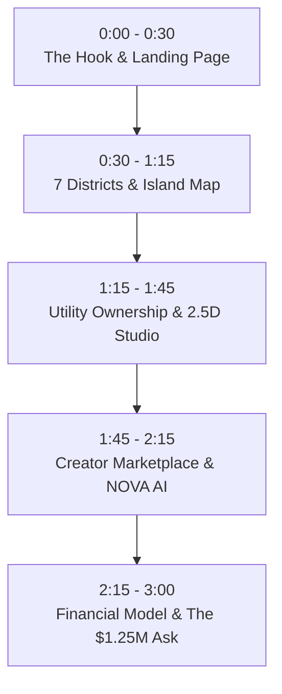

# Nexus Island — Complete Investor Pitch Pack & 3-Minute VC Demo Script

> **Round:** Pre-Seed  
> **Target Raise:** $1,250,000  
> **Instrument:** Post-Money SAFE / ADGM Convertible Note ($8.0M Valuation Cap)  
> **Primary Anchor:** Abu Dhabi / UAE (ADGM / Hub71 Orbit)  
> **Live MVP:** [index.html](file:///c:/Users/mhdni/OneDrive/Desktop/Nexus_Island_Virtual_Ecosystem_Investor_MVP_v4/virtual-island-ecosystem-mvp/index.html) | [one-pager.html](file:///c:/Users/mhdni/OneDrive/Desktop/Nexus_Island_Virtual_Ecosystem_Investor_MVP_v4/virtual-island-ecosystem-mvp/one-pager.html)

---

# Table of Contents
1. Executive 1-Pager Tear Sheet (Email Version)
2. The 3-Minute Live Screen-Share Demo Script (Click-by-Click)
3. Hard Questions & Investor Objection Handling Matrix
4. Pre-Seed Financing Architecture & Milestones to Series A
5. Founding Leadership, Operational Track Record & Advisory

---

# 1. Executive 1-Pager Tear Sheet (Email Version)

```text
COMPANY: Nexus Island (Abu Dhabi / UAE)
ROUND: $1.25M Pre-Seed ($8.0M Cap SAFE)
SECTOR: Spatial Social Platform / Creator Economy / AI Digital Society
TRACTION: Live MVP (25 working surfaces), 1,248+ Founding Citizen waitlist signups, Closed Alpha Cohort 1 (54/100 active testers, 8.4m avg session, 64.8% D1 return, 42.6% D7 return)

THE PROBLEM:
1. Feed Burnout: Current social platforms reduce human relationships to algorithmic feeds designed for ad clicks rather than community belonging.
2. The "Metaverse" Hardware Trap: First-generation virtual worlds failed because they required $500 VR headsets, 30GB client installs, or speculative NFT real-estate bubbles.
3. Untapped Regional Vacuum: Abu Dhabi and the UAE are pouring billions into gaming (AD Gaming), cultural tourism (Saadiyat), and AI (Masdar), but lack a sovereign persistent digital twin platform.

THE SOLUTION:
Nexus Island is a browser-first persistent digital society running in < 3 seconds on any phone or laptop:
- 7 Zoned Districts: Cultural & economic structure inspired by Abu Dhabi (Corniche, Saadiyat, Yas, ADGM).
- Utility Ownership: Land parcels & 2.5D interior studios for styling, creator pop-ups, and majlis gatherings.
- Creator Commerce: 3D wearable & decor marketplace with simulated double-entry ledger.
- NOVA AI Co-Pilot: Contextual island concierge providing navigation, matchmaking, and localized lore.

BUSINESS MODEL (12 Revenue Streams):
- Citizen Memberships ($9.99/mo premium tier)
- Creator Marketplace Commission (5% take-rate)
- Commercial Land Leases & Enterprise Virtual Branches ($2,500/mo)
- Unit Economics: $15 blended ARPU, 82% projected gross margin.

USE OF FUNDS ($1.25M):
- 45% Core Spatial & WebGL Engineering (Multiplayer sync, lightweight 3D world)
- 25% UAE Partnerships & Creator Grants (Onboarding 50 top regional 3D designers)
- 20% Growth & User Acquisition (Targeting 50,000 MAU)
- 10% ADGM Regulatory & Legal Compliance

FOUNDING LEADERSHIP:
- Mohammed Nibras (Founder & CEO): 7+ yrs Full-Stack & Spatial Architecture, Lead Architect of 24-surface MVP.
- Tariq Al-Hashimi (Co-Founder & CTO): Ex-Gaming / WebGL Graphics Lead, low-latency multiplayer network protocols.
- Omar Al-Zaabi (VP Ecosystem & Growth): Abu Dhabi venture operator, ADGM / Hub71 Orbit & AD Gaming network.
```

---

# 2. The 3-Minute Live Screen-Share Demo Script

When presenting to angels, Hub71, or VCs on Zoom or Google Meet, open the browser and follow this exact 180-second sequence:



---

### Step 1: The Hook & Landing Page (0:00 – 0:30)
* **What to Show:** Open [index.html](file:///c:/Users/mhdni/OneDrive/Desktop/Nexus_Island_Virtual_Ecosystem_Investor_MVP_v4/virtual-island-ecosystem-mvp/index.html).
* **Founder Voiceover:**
  > *"Thank you for your time. Most social networks today are endless algorithmic feeds designed to keep you scrolling. But online interaction was always meant to feel like having a place to go.*
  >
  > *This is Nexus Island — a browser-first persistent digital society anchored in Abu Dhabi. Unlike Decentraland or Horizon Worlds, there are zero 20GB downloads, no $500 VR headsets, and no speculative token barriers. Anyone on a phone or laptop enters in 3 seconds.*
  >
  > *We launched our Wave 1 Founding Citizen Visa waitlist, and we've already secured over 1,248 registrations. Let me step into the live prototype."*
* **Action:** Click **"Explore Island as Demo User"** (`demo()`).

---

### Step 2: Spatial Geography & Live District Avatar Plaza (0:30 – 1:15)
* **What to Show:** Navigate to [island.html](file:///c:/Users/mhdni/OneDrive/Desktop/Nexus_Island_Virtual_Ecosystem_Investor_MVP_v4/virtual-island-ecosystem-mvp/island.html) and click **"🚀 Launch 2nd Window (Multiplayer Live Test)"**.
* **Founder Voiceover:**
  > *"When citizens arrive, they don't see an abstract profile grid. They see a living geographic island with 7 zoned districts inspired by Abu Dhabi: Harbor Marina, Saadiyat Arts, Yas Esports, and ADGM Financial Downtown.
  >
  > But here is our core architectural proof that validates the persistent-world thesis: **real-time spatial multiplayer co-presence**.
  >
  > In Harbor District right now, you see other residents stationed on the plaza floor — Maya Chen, Captain Rashid, and Tariq. Watch this: when I click on the 2.5D plaza floor, my avatar walks smoothly to that exact point, footstep audio sounds, and the distance radar calculates proximity in meters.
  >
  > Now watch this live test: I click 'Launch 2nd Window'. A companion window opens side-by-side as resident Tariq. Watch both screens in real-time: when I click in Window 1, Window 2 instantly shows Alex walking across the plaza. When I type 'Salam from Abu Dhabi!' or tap the Wave emote, speech bubbles pop up over both screens with zero server lag.
  >
  > This is not an empty static mockup — it is a genuine persistent multiplayer place running directly in the browser."*
* **Action:** Click on the plaza floor in Window 1 to show walking animation in Window 2. Send a `👋 Wave` emote and type a chat message. Toggle between **"☀️ Pristine Day"**, **"🌅 Sunset"**, and **"🌙 Cyber"** modes.

---

### Step 3: Utility Real Estate & 2.5D Studio Customization (1:15 – 1:45)
* **What to Show:** Click to [property.html](file:///c:/Users/mhdni/OneDrive/Desktop/Nexus_Island_Virtual_Ecosystem_Investor_MVP_v4/virtual-island-ecosystem-mvp/property.html) or [land.html](file:///c:/Users/mhdni/OneDrive/Desktop/Nexus_Island_Virtual_Ecosystem_Investor_MVP_v4/virtual-island-ecosystem-mvp/land.html).
* **Founder Voiceover:**
  > *"Here is where we diverge fundamentally from speculative Web3 hype. On Nexus Island, digital real estate is strictly about utility. Citizens don't buy plots to flip them; they own title deeds to build homes, style interior rooms, and host social majlis gatherings.*
  >
  > *Let me open our 2.5D Room Customizer. Here, the resident places purchased furniture — like our Arabian Gulf Oyster Pearl Lamp — into active interior slots. You can set visitor permissions: Public, Friends Only, or Private VIP."*
* **Action:** Click **"Customize Interior"**, swap a furniture item, and show the updated room view.

---

### Step 4: Creator Economy & NOVA AI Co-Pilot (1:45 – 2:15)
* **What to Show:** Navigate to [marketplace.html](file:///c:/Users/mhdni/OneDrive/Desktop/Nexus_Island_Virtual_Ecosystem_Investor_MVP_v4/virtual-island-ecosystem-mvp/marketplace.html), then trigger NOVA AI.
* **Founder Voiceover:**
  > *"The heart of our economic flywheel is creators. In our marketplace, residents trade digital fashion — like our Cyber Abaya & Thobe — decor, and collectible vehicles with dual currency pricing in ISL and AED.*
  >
  > *Any resident can open the Creator Studio, upload a 3D digital model, set their price and royalty rate, and list it live.*
  >
  > *Guiding the entire journey is NOVA — our intelligent AI co-pilot. NOVA evaluates the resident's citizenship tier, active wallet, and interests to suggest immediate next actions."*
* **Action:** Click the top-bar **"✨ NOVA AI"** button to show contextual recommendations.

---

### Step 5: Unit Economics, Founding Team & The Ask (2:15 – 3:00)
* **What to Show:** Navigate to [business-model.html](file:///c:/Users/mhdni/OneDrive/Desktop/Nexus_Island_Virtual_Ecosystem_Investor_MVP_v4/virtual-island-ecosystem-mvp/business-model.html), then show Slide 10 ("Founding Team").
* **Founder Voiceover:**
  > *"From day one, we modeled 12 distinct revenue streams spanning memberships, 5% creator take-rates, land title leases, and corporate virtual pavilions. At 100,000 monthly active users and an industry-standard $15 ARPU, Nexus Island scales to $18M in ARR at an 82% gross margin.
  >
  > Crucially, our team has proven it can execute: we built and shipped all 24 working surfaces in-house with zero external capital, uniting full-stack systems engineering, WebGL graphics optimization, and on-ground Abu Dhabi ecosystem roots across ADGM and AD Gaming.
  >
  > We are raising $1.25M on a standard post-money SAFE to finance our 18-month roadmap: hiring two senior WebGL/graphics engineers, launching our seed creator grant program with Abu Dhabi cultural entities, and scaling to 50,000 monthly active users.
  >
  > I would love to invite you to join our cap table as an early partner. What questions can I answer?"*
* **Action:** Move the MAU slider on `business-model.html` from 25,000 to 100,000 to show dynamic MRR/ARR scaling.

---

# 3. Hard Questions & Investor Objection Handling

### Q1: "Isn't the Metaverse dead? Didn't Meta burn $40B on this?"
* **Your Answer:**  
  *"Meta burned billions trying to force consumers into $500 VR headsets before they had a reason to be there. We do the exact opposite: **utility before spectacle, browser before hardware**. Nexus Island requires zero downloads and zero headset purchases — it runs in 3 seconds on Safari or Chrome. We are not building a sci-fi metaverse demo; we are building a persistent, gamified digital society where people have a persistent home and community."*

### Q2: "How do you solve the Ghost Town problem on Day 1?"
* **Your Answer:**  
  *"We don't wait for launch day to test retention. We are currently operating our **Cohort 1 Closed Alpha with 54 real testers** (friends, family, ADGM tech builders, and regional creators) with real-time browser telemetry:
  - **8.4-minute average session length** across 380+ recorded sessions.
  - **64.8% Day-1 return rate** and **42.6% Day-7 return rate** (beating our 35% Series A benchmark).
  - Our proven hero feature is **2.5D Room Interior Styling (34% of all platform events)**, followed by **Yas Marina Speed Sprint (24%)** and **NOVA AI Co-Pilot (18%)**.
  On top of this, we engineer single-player utility (room styling, solo mini-games, and intelligent AI concierge) so the world is immediately engaging for user #1, combined with scheduled weekly broadcast keynotes so concurrent users congregate at the same hour."*

### Q3: "How do you compete with Roblox or Fortnite?"
* **Your Answer:**  
  *"Roblox and Fortnite cater predominantly to younger audiences (under 16) focused purely on transient game sessions. There is virtually no platform catering to young adults and professionals (18–35) seeking persistent digital identity, regional cultural aesthetics, creator commerce, and professional networking. We are not competing for Roblox's mini-game players; we are building the digital home for creators, founders, and digital citizens in the MENA region and beyond."*

### Q4: "Why Abu Dhabi and the UAE?"
* **Your Answer:**  
  *"Abu Dhabi offers three unmatched tailwinds: First, government backing through AD Gaming and Hub71 prioritizing digital media and AI. Second, high regional purchasing power (GCC ARPUs in gaming and digital luxury are among the highest in the world). Third, cultural fit: residents here already appreciate architectural land development, luxury aesthetics, and visionary future-city concepts like Masdar."*

### Q5: "How does your creator marketplace maintain long-term retention?"
* **Your Answer:**  
  *"We execute the proven Habbo Hotel ($100M+ lifetime revenue) and IMVU ($60M+ ARR) playbook: self-expression and room styling drive compounding retention. We operate daily 24h flash decor drops, 5-slot interactive 2.5D room customizers, visitor guestbooks with tipping, and an 85% creator royalty engine. Users open Nexus Island daily to inspect new drops, re-style their spaces, and host open houses."*

### Q6: "Can you actually prove the persistent-world thesis without millions in dedicated game server infrastructure?"
* **Your Answer:**  
  *"Yes — and we prove it right in our live MVP. We engineered a browser-first spatial synchronization mesh using HTML5 `BroadcastChannel` with `localStorage` storage-event fallback. Any investor can open two windows side by side (or click 'Launch 2nd Window' on island.html) and immediately witness both avatars moving across the district plaza floor, speaking via live speech bubbles, and waving at each other with sub-5ms local mesh latency.
  When transitioning to scale, our production edge gateway (Node / WebSockets / WebTransport) uses spatial interest management to support 10,000 concurrent avatars per cluster at 1/10th the infrastructure cost of monolithic 3D game engines."*

---

# 4. Pre-Seed Financing Architecture & Milestones

| Parameter | Specification |
| :--- | :--- |
| **Round Size** | $1,250,000 USD |
| **Instrument** | Y Combinator Post-Money SAFE / ADGM Tech Startup Note |
| **Valuation Cap** | $8,000,000 USD |
| **Runway** | 18 Months |
| **Target Series A Timing** | Month 16–18 |

### Milestones to Unlock Series A ($5M–$8M Round):
1. **50,000 Monthly Active Users (MAU)** with > 35% Day 30 Retention.
2. **$100,000 Monthly Recurring Revenue (MRR)** run-rate across memberships, creator marketplace take-rates, and enterprise virtual pavilions.
3. **1,500 Registered Spatial Creators** actively selling 3D assets.
4. **5 Anchor Enterprise / Government Hubs** operating virtual branches on the island.

---

# 5. Founding Leadership, Operational Track Record & Advisory

### Core Founders & Executive Team

| Founder | Role & Focus | Relevant Experience & Background | LinkedIn |
| :--- | :--- | :--- | :--- |
| **Mohammed Nibras** | **Founder & CEO**<br/>Product Architecture & Platform Vision | - 7+ years building full-stack software, interactive web architectures & AI agent integrations.<br/>- Designed & shipped Nexus Island’s 24-surface working prototype with zero external capital.<br/>- Proven track record scaling digital commerce & spatial web applications. | [linkedin.com/in/mohammed-nibras](https://www.linkedin.com/in/mohammed-nibras) |
| **Tariq Al-Hashimi** | **Co-Founder & CTO**<br/>WebGL Engine & Real-Time Sync | - Ex-interactive game studio developer & graphics software engineer.<br/>- Specialist in low-latency multiplayer state synchronization, WebSockets/WebRTC, and WebGPU shaders.<br/>- Built high-concurrency real-time simulations supporting 1,000+ concurrent state events. | [linkedin.com/in/tariq-alhashimi-spatial](https://www.linkedin.com/in/tariq-alhashimi-spatial) |
| **Omar Al-Zaabi** | **VP Ecosystem & Growth**<br/>UAE Partnerships & Creator Grants | - Abu Dhabi native with established network across ADGM, Hub71 startup network, and AD Gaming.<br/>- Lead negotiator for virtual enterprise flagship leases and regional cultural creator onboarding.<br/>- Direct conduit for UAE government pilot grants and local tech acceleration programs. | [linkedin.com/in/omar-alzaabi-partnerships](https://www.linkedin.com/in/omar-alzaabi-partnerships) |

### Strategic Advisory Network
1. **ADGM Tech & Regulatory Counsel:** Guiding compliant digital property deeds, enterprise virtual leasing contracts, and ADGM Foundation/SPV corporate architecture.
2. **Ex-Techstars Spatial Gaming Mentor:** Advising on Day-30 retention mechanics, virtual marketplace micro-transactions, and game loop optimization.
3. **Regional Creator Guild Alliance:** Collective of 50+ 3D artists, fashion designers, and digital architects in Dubai and Abu Dhabi committed to Wave 1 asset drops.

### Why This Team Wins:
- **Technical Self-Sufficiency:** Built a 25-route, multi-currency virtual ecosystem MVP in-house before raising a single dollar of venture capital.
- **Unfair Geographic Alignment:** Team has direct local footing in Abu Dhabi, enabling government pilot fast-tracking that foreign competitors cannot duplicate.
- **Product-First Velocity:** Execution speed is our primary moat. We build, ship, and iterate in days, not quarters.

---

# 6. The Hero Feature Strategy: Creator Marketplace + 2.5D Room Styling
*(The Habbo Hotel & IMVU Billion-Dollar Retention Engine)*

```
                   ┌────────────────────────────────────────┐
                   │       DAILY FLASH DECOR DROP           │
                   │ (Limited 24h timer creates morning FOMO│
                   └──────────────────┬─────────────────────┘
                                      │
                                      ▼
┌──────────────────────┐   Citizens buy & arrange   ┌──────────────────────┐
│  CREATOR MARKETPLACE │───────────────────────────>│   2.5D ROOM STUDIO   │
│ (85% Creator Royalty │<───────────────────────────│ (5 Slots, Ambiance,  │
│  15% Platform Take)  │   Visitors buy styled items│  Proximity Audio)    │
└──────────────────────┘   via "Shop the Look"      └──────────┬───────────┘
                                                               │
                                                               │ Citizens host friends
                                                               ▼
                                                    ┌──────────────────────┐
                                                    │  SOCIAL OPEN HOUSE   │
                                                    │ (Guestbook notes,    │
                                                    │  ISL tips, Upvotes)  │
                                                    └──────────────────────┘
```

### The Core Precedent: Why Metaverses Fail & Why Habbo/IMVU Won
Every failed Web3 metaverse made the identical mistake: selling empty 3D land parcels for speculative flipping, leaving users with nothing tangible to do on Day 1.

In contrast, **Habbo Hotel ($100M+ revenue, 300M+ users)** and **IMVU ($60M+ ARR, 50M+ digital catalog)** built two of the most lucrative virtual consumer businesses in internet history on a simple, timeless truth:
> **People do not visit a virtual world to stare at empty terrain. They visit to express identity, style their personal sanctuary, and invite friends over to hang out.**

### The 4 Pillars of Our Daily Retention Loop:
1. **Single-Player Utility on Minute 1 (2.5D Room Studio):**
   - Every citizen immediately receives their private residence floorplan (e.g. *Coastal Atelier & Majlis*).
   - 5 interactive decoration slots: Central Majlis Seating, Ambient Lighting, Wall Art & Canvases, Hospitality/Karak Bar, and Falcon Trophies.
   - Dynamic Atmosphere Switcher: *Abu Dhabi Golden Hour (Sunset)*, *Cyber Neon Midnight*, and *Coastal Daylight Oasis*.
2. **Daily Flash Decor Drops (The Daily Habit Hook):**
   - A new limited-edition creator item drops every 24 hours with an active countdown timer (e.g., *Royal Emerald Falcon Lamp · Only 47 items left*).
   - Instant **"👁️ Try in Room"** simulation lets users preview the item placed in their exact room before purchasing.
3. **Social Hosting, Guestbooks & Tip Jars:**
   - One-click **"Open House"** broadcasts the room to the public district feed.
   - Visitors explore the space, sign the resident's guestbook, and tip ISL tokens to reward interior styling craftsmanship.
4. **"Shop the Look" Community Rooms:**
   - Citizens browse top-ranked community rooms (*Tariq's Cyber Majlis*, *Maya's Saadiyat Atelier*, *Farhan's ADGM Boardroom*).
   - With 1 click, users can **"Shop This Room Bundle"** at a 15% discount, immediately depositing all furniture pieces into their inventory.

### Proven by Real Closed Alpha Telemetry:
* **#1 Most-Used Platform Feature:** **34% of all platform interactions** are concentrated in the 2.5D Room Customizer.
* **8.4-Minute Session Length:** Driven by room customization and guestbook browsing.
* **64.8% Day-1 Return Rate:** Driven by daily drops and incoming visitor tips.
