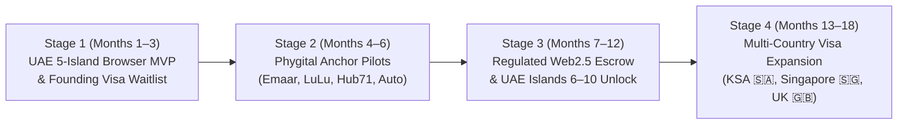
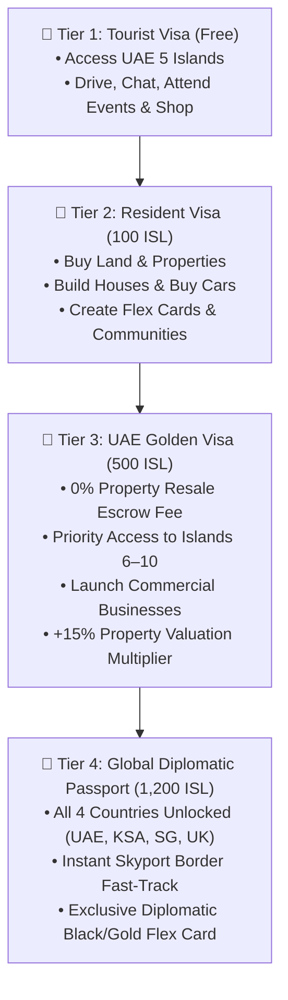
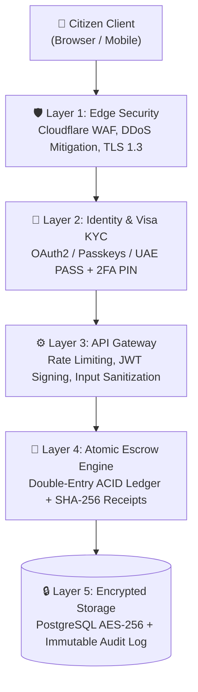

# Nexus Island — Complete Startup Execution, Security, Revenue & Technical Implementation Guide

> **Platform Vision:** Multi-Country Persistent Virtual World Ecosystem (GTA-Style Open World + Google Maps Cartography + Regulated Web2.5 Economy)  
> **Launch Focus:** United Arab Emirates (UAE) — 5 Core District-Islands (Expandable to 10+ Islands)  
> **4 Planned Countries:** 🇦🇪 UAE (Active Launch) · 🇸🇦 Saudi Arabia (KSA) · 🇸🇬 Singapore · 🇬🇧 United Kingdom (UK)  
> **Anchor Enterprise Verticals:** Real Estate Developers (Emaar) · Hypermarkets & Retail (LuLu) · Automotive Showrooms · Financial & Startup Hubs (ADGM, Hub71) · Shopping Malls  

---

## Table of Contents

1. [Executive Execution Strategy: How to Build & Launch Perfectly](#1-executive-execution-strategy-how-to-build--launch-perfectly)
2. [The 4-Country Virtual Visa & Immigration System](#2-the-4-country-virtual-visa--immigration-system)
3. [The UAE 5-Island District Model & 10+ Island Expansion Masterplan](#3-the-uae-5-island-district-model--10-island-expansion-masterplan)
4. [GTA-Style Real-World Travel, Real Estate (Buy/Build/Sell) & Social Loop](#4-gta-style-real-world-travel-real-estate-buybuildsell--social-loop)
5. [Enterprise & Brand Integration Playbook (Emaar, LuLu, ADGM, Hub71, Auto)](#5-enterprise--brand-integration-playbook-emaar-lulu-adgm-hub71-auto)
6. [Nexus Shield: Enterprise-Grade Security & Escrow Architecture](#6-nexus-shield-enterprise-grade-security--escrow-architecture)
7. [14-Stream Revenue Model & Maximum User Benefits Flywheel](#7-14-stream-revenue-model--maximum-user-benefits-flywheel)
8. [High-Impact Strategic Additions to Make the Startup Unstoppable](#8-high-impact-strategic-additions-to-make-the-startup-unstoppable)
9. [Full Technical Architecture & Step-by-Step Build Guide](#9-full-technical-architecture--step-by-step-build-guide)
10. [Legal, Regulatory & Compliance Setup in the UAE (ADGM / VARA / TDRA)](#10-legal-regulatory--compliance-setup-in-the-uae-adgm--vara--tdra)

---

## 1. Executive Execution Strategy: How to Build & Launch Perfectly

Most virtual world startups fail because they make three fatal mistakes:
1. **They build an empty, massive 3D world first** requiring 20GB downloads or $500 VR headsets, resulting in a "ghost town."
2. **They rely on volatile crypto tokens** that invite scammers, rug-pulls, and regulatory bans.
3. **They treat real estate as pure speculation** rather than giving users daily social, gaming, and real-world ("phygital") utility.

### The Winning 4-Stage Execution Formula

- **Stage 1 — High-Density UAE Launch (Months 1–3):** Launch entirely in the browser (zero install friction, <3 second load time on mobile and desktop). Concentrate all early users into the **5 UAE Islands** using the **Virtual Visa** as an exclusive onboarding pass.
- **Stage 2 — B2B Anchor Partnerships via Co-Marketing (Months 4–6):** Onboard flagship regional brands (**Emaar, LuLu, Hub71, ADGM, Prestige Auto**) by offering them turnkey virtual storefronts connected to real-world customer vouchers. When LuLu or Emaar promotes their virtual island storefront to their millions of UAE customers, your Customer Acquisition Cost (CAC) drops near $0.
- **Stage 3 — Secondary Property Market & Islands 6–10 (Months 7–12):** Once Islands 1–5 reach 80% land occupancy, unlock the **Secondary Property Escrow Market** (allowing early citizens to build houses and sell properties for a profit) and open **Islands 6–10** for expansion.
- **Stage 4 — International Visa Expansion (Months 13–18):** Activate the **International Skyport** on Island 1 and issue visas for **Saudi Arabia (KSA)**, **Singapore**, and the **United Kingdom (UK)**.

---

## 2. The 4-Country Virtual Visa & Immigration System

Instead of a generic "Sign Up" form, users enter the ecosystem through a **Sovereign Virtual Visa & Passport System**. Every user receives a cryptographic Digital Passport that stores their country visas, residency tier, reputation score, and asset net worth.

### 2.1 The 4 Planned Countries

| Country | Flag | Launch Status | Entry Requirement | Signature Virtual Regions / Districts | Local Currency Peg |
| :--- | :---: | :--- | :--- | :--- | :--- |
| **1. United Arab Emirates (UAE)** | 🇦🇪 | **LIVE (Primary Focus)** | **UAE Virtual Visa** (Free for Wave 1 Founding Citizens) | **5 Active District-Islands** (ADGM/Hub71 Core, Emaar Palm Island, Yas Motorsport Island, Masdar/Saadiyat AI Island, LuLu Marina & Mangrove Island) + **5 Expansion Islands** | `1 ISL = 0.50 AED` |
| **2. Saudi Arabia (KSA)** | 🇸🇦 | **Wave 2 Expansion** | **KSA e-Visa** (`250 ISL` or Golden/Diplomatic Passport) | **Riyadh KAFD Financial Core**, **NEOM The Line Spatial Portal**, **Red Sea Luxury Atoll**, **Qiddiya Gaming Citadel** | `1 ISL = 0.50 SAR` |
| **3. Singapore (SGP)** | 🇸🇬 | **Wave 3 Expansion** | **Singapore Tech Visa** (`300 ISL` or Diplomatic Passport) | **Marina Bay Sky-Gardens**, **Sentosa Cove Villa Island**, **One-North FinTech & AI Quay**, **Orchard Retail Strip** | `1 ISL = 0.18 SGD` |
| **4. United Kingdom (UK)** | 🇬🇧 | **Wave 4 Expansion** | **UK Royal Visa** (`350 ISL` or Diplomatic Passport) | **Canary Wharf Banking Spire**, **Mayfair & Knightsbridge Luxury**, **Thames Innovation Pier**, **Silverstone Racing Circuit** | `1 ISL = 0.11 GBP` |

### 2.2 The 4 Visa Tiers (Progression & Monetization)

---

## 3. The UAE 5-Island District Model & 10+ Island Expansion Masterplan

To prevent an overcrowded single map while keeping user density high, the UAE territory is organized as an **Archipelago of 5 Connected District-Islands**, linked by **drivable GTA-style highway causeway bridges**, yacht ferries, and eVTOL air taxis, with **Islands 6–10+** pre-mapped for future expansion.

### 3.1 The 5 Active UAE Islands (Phase 1 Core)

1. **Island 1: Nexus Main — ADGM, Hub71 & Harbor Financial Island (`nexus-main`)**
   - **Focus:** Corporate headquarters, financial regulation, startup incubation, and waterfront arrival.
   - **Anchor Landmarks:** **ADGM Apex Tower**, **Hub71 Startup Campus**, **Harbor Marina Promenade**, and the **UAE International Skyport (Border & Visa Terminal)**.
2. **Island 2: Emaar Palm & Nurai Luxury Residential Island (`nurai-cove`)**
   - **Focus:** High-status residential land plots, beachfront villas, custom house construction, and private social majlis gatherings.
   - **Anchor Landmarks:** **Emaar Virtual Sales & Architecture Center**, **Palm Sanctuary Lagoon**, **Overwater VIP Villas**.
3. **Island 3: Yas Motorsport & Supercar Dealership Island (`yas-arena`)**
   - **Focus:** GTA-style racing circuits, automotive showrooms, vehicle tuning, and esports tournaments.
   - **Anchor Landmarks:** **Prestige Motors & EV Supercar Showroom**, **Yas Grand Prix Circuit**, **Yas Cyber Esports Arena**.
4. **Island 4: Masdar AI & Saadiyat Cultural Island (`masdar-atoll`)**
   - **Focus:** Creator economy, 3D digital art galleries, fashion runways, and AI supercomputing.
   - **Anchor Landmarks:** **Louvre-Style Crystal Pavilion**, **NOVA AI Quantum Spire**, **Saadiyat Creator Ateliers**.
5. **Island 5: LuLu Retail Mall & Eastern Mangrove Sanctuary (`mangrove-sanctuary`)**
   - **Focus:** Mass retail commerce, shopping malls, phygital voucher redemption, and eco-tourism.
   - **Anchor Landmarks:** **LuLu Virtual Hypermarket & Department Store**, **Galleria Virtual Mall**, **Mangrove Eco-Boardwalk**.

### 3.2 Future Expansion: Islands 6–10+ (Scalable District Architecture)
As population scales beyond 25,000 MAU, new islands are unlocked dynamically without altering core engine code:
- **Island 6:** *Dubai Downtown & Burj Frontier Island* (Sky-villas & luxury couture mall)
- **Island 7:** *Al Maryah Sovereign Banking Atoll* (Institutional wealth & private banking suites)
- **Island 8:** *Saadiyat North Couture & Museum Isle* (Global fashion weeks & live concert amphitheater)
- **Island 9:** *Jebel Ali Global Trade & Maritime Port* (B2B virtual expo halls & logistics twins)
- **Island 10:** *Al Ain Oasis & Hajar Mountain Retreat* (Wellness, heritage estates & desert rally tracks)

---

## 4. GTA-Style Real-World Travel, Real Estate (Buy/Build/Sell) & Social Loop

### 4.1 Google Maps + GTA Dual-Mode World Engine
- **Macro View (Google Maps Mode):** Smooth pan, zoom (`0.35x` to `3.0x`), satellite/street/deed layers, POI search, and 1-click GPS route plotting.
- **Ground View (GTA Free-Roam Mode):**
  - Walk/sprint across islands (`WASD` + `Shift`) or press `[F]` to enter owned or test-drive vehicles.
  - Drive across **4 Inter-Island Highway Bridges** connecting Island 1 to Islands 2, 3, 4, and 5 with real-time speedometer, drift physics, nitro boost, and radio stations.
  - Proximity detection (`[E]` prompt) when approaching any building, land parcel, dealership, mall, or the International Skyport.

### 4.2 Complete Real Estate Lifecycle: Buy Land → Build House → Sell Property
1. **Step 1 — Acquire Land Parcel:** Users browse available plots across the 5 islands (zoned Residential, Commercial, Creator, or Waterfront) and purchase a sovereign Title Deed via **Nexus Shield Escrow**.
2. **Step 2 — Construct Custom House (Emaar Blueprint System):** Owners select their land plot and commission a house build from curated architectural blueprints:
   - *Emaar Beachfront Contemporary Villa* (`450 ISL` build cost → adds `+750 ISL` to property value)
   - *Royal Emirati Majlis Courtyard Estate* (`650 ISL` build cost → adds `+1,100 ISL` to property value)
   - *ADGM Executive Glass Sky-Villa* (`550 ISL` build cost → adds `+900 ISL` to property value)
   - *Masdar Solar-Tech Smart Residence* (`350 ISL` build cost → adds `+580 ISL` to property value)
3. **Step 3 — Furnish & Host (2.5D Room Studio):** Owners decorate interior slots, set visitor privacy (Public, Friends, VIP), and collect Guestbook tips and upvotes.
4. **Step 4 — Sell Property / Land on the Secondary Market:** Owners can list and sell their developed land or properties at appreciated market valuations. The platform's **Atomic Escrow Engine** deducts a **5% commission** (0% for UAE Golden Visa holders) and credits the net proceeds directly to the seller's wallet.

### 4.3 Social Graph, Communities, Events & Viral Flex Cards
- **Island Flex Cards:** 1-click generator creating a luxury status card displaying the user's **Name, Level, Net Worth (ISL & AED), Visa Tier, Country Stamps (🇦🇪 🇸🇦 🇸🇬 🇬🇧), Properties & Cars Owned, and Nexus Shield Verified Seal**, formatted for Instagram Stories, WhatsApp, and X.
- **Friends, Direct Chat & Spatial Multiplayer:** Real-time presence sync, speech bubbles, emotes, friend requests, and private messaging.
- **Communities & Live Events:** Specialized guilds (ADGM Founders, Yas Pro Gamers, Saadiyat Creators) and interactive broadcast stages with floating audience reactions.

---

## 5. Enterprise & Brand Integration Playbook (Emaar, LuLu, ADGM, Hub71, Auto)

To attract major enterprises, each vertical gets a purpose-built interactive experience that drives measurable ROI (leads, sales, brand engagement, and footfall):

| Enterprise Partner | Virtual World Role | Interactive Features in Platform | Real-World Value to Partner |
| :--- | :--- | :--- | :--- |
| **🏗️ Emaar (Building Developer)** | Master Architectural Developer & Villa Builder | • Users inspect 3D/2.5D villa blueprints • Users pay ISL to construct Emaar-branded homes on their virtual land • Off-plan showcase for real UAE developments | • Brand affinity with young affluent investors • Direct lead capture for real-world off-plan property launches |
| **🛒 LuLu Hypermarket (Retailer)** | Anchor Retail & Phygital Department Store | • Walk-in virtual hypermarket on Island 5 • Buy virtual home packs + unlock **real-world LuLu discount vouchers** (`LULU-NEXUS-15`) | • Drives measurable online/offline grocery orders • Gamified loyalty acquisition |
| **🏎️ Vehicle Companies & Dealerships** | Interactive Auto Showroom & Test-Drive Track | • Users walk into the showroom on Yas Island • Inspect vehicle specs (Speed, Handling, Accel) • **1-Click Test Drive** on the Yas Circuit or buy for garage | • Virtual test-drives of new EV/luxury models • High-intent booking leads for real test drives |
| **🏛️ ADGM (Financial Center)** | Sovereign Corporate Registry & Escrow Authority | • Virtual RegLab & Corporate Licensing desk • Users register virtual businesses & inspect Escrow compliance | • Positions ADGM as the premier digital economy jurisdiction |
| **🚀 Hub71 (Tech Ecosystem)** | Startup Accelerator, Co-Working & VC Pitch Hub | • Virtual founder campus & demo day stage • Founders apply for innovation grants & connect with MENA angels | • Global founder deal-flow & virtual pitch screening |
| **🛍️ Shopping Malls (Galleria / Marina Mall)** | Multi-Brand Retail Atrium | • Leasable digital storefronts for fashion, F&B, and creator brands • Social hangout plaza with live events | • Recurring digital tenant lease revenue & omnichannel shopping |

---

## 6. Nexus Shield: Enterprise-Grade Security & Escrow Architecture

Security is a core competitive advantage of your startup. Below is the **Defense-in-Depth Security Architecture** ("Nexus Shield") designed to protect every user identity, chat interaction, and financial transaction.

### 6.1 Five Pillars of Platform Security
1. **Verified Identity & Anti-Sybil Visa Gate (Layer 1 & 2):**
   - Integration-ready for **UAE PASS** / OAuth2 / WebAuthn Passkeys so every Golden Visa and Business Owner account is tied to a verified human identity.
   - **Step-Up Authentication (Transaction PIN / 2FA):** High-value actions (selling land, transferring >500 ISL, changing payout settings) require a 4-digit Security PIN or 2FA code.
2. **Atomic Property & Transaction Escrow ("Zero-Scam Guarantee"):**
   - Users **never** send funds directly to another user's wallet during a land, house, or vehicle trade.
   - Instead, funds are locked in the **Nexus Shield Escrow Vault**:
     1. Buyer deposits ISL into Escrow Contract.
     2. System verifies Seller owns the unencumbered Title Deed (`landId` / `propertyId`).
     3. Ownership registry atomically swaps Title Deed to Buyer and releases net ISL to Seller in a single ACID database transaction.
3. **Double-Entry Immutable Ledger & Cryptographic Receipts (`SHA-256`):**
   - Balances are never stored as a simple mutable number in production; every credit has a matching debit in an append-only ledger table.
   - Every transaction generates a verifiable cryptographic receipt hash (`0xNX-...`) that both parties can inspect and export.
4. **Real-Time Fraud & Anomaly Detection:**
   - Velocity limits on wallet top-ups and P2P transfers to prevent money laundering or chargeback fraud.
   - Closed-loop currency model (`ISL` credits purchased via regulated fiat gateways like Stripe, Apple Pay, or UAE Jaywan) prevents unauthorized external crypto wash-trading.
5. **Safe Social Interactions & AI Moderation:**
   - Strict XSS output escaping (`esc()` across all user-generated strings), real-time profanity/scam-link filtering in chat and guestbooks, 1-click user blocking, and encrypted private messaging.

---

## 7. 14-Stream Revenue Model & Maximum User Benefits Flywheel

### 7.1 Complete 14-Stream Revenue Breakdown

| # | Revenue Stream | Type | Pricing / Take-Rate | Target Margin |
| :- | :--- | :--- | :--- | :---: |
| **1** | **Virtual Visa Upgrades (Resident, Golden, Diplomatic)** | B2C | `100 ISL` – `1,200 ISL` ($13 – $160) | 95% |
| **2** | **Primary Land Parcel Drops (Islands 1–10)** | B2C | `450 ISL` – `2,500 ISL` ($60 – $340) | 95% |
| **3** | **House Construction Blueprints (Emaar & Custom)** | B2C | `350 ISL` – `650 ISL` per build | 90% |
| **4** | **Secondary Property & Land Escrow Commission** | Fee | **5% fee** on all P2P property/land resales | 98% |
| **5** | **Vehicle Dealership Sales & Custom Tuning** | B2C | `550 ISL` – `2,500 ISL` per vehicle | 90% |
| **6** | **Citizen Plus & VIP Subscriptions** | SaaS | **$9.99/mo** (Resident Plus) · **$29.99/mo** (Royal VIP) | 85% |
| **7** | **Creator Marketplace Commission** | Fee | **15% platform take-rate** (85% paid to Creator) | 85% |
| **8** | **Flex Card Luxury Skins & Verified Badges** | B2C | `50 ISL` – `250 ISL` | 98% |
| **9** | **Anchor Enterprise Flagships (Emaar, LuLu, Auto)** | B2B | **$2,500 – $15,000 / month** per flagship hub | 80% |
| **10** | **Phygital Retail Affiliate Commissions** | B2B2C | **3% – 8% affiliate fee** on redeemed real-world orders | 95% |
| **11** | **Virtual Mall & Corporate Office Leases (ADGM/Hub71)** | B2B | **$299 – $1,500 / month** per commercial suite | 88% |
| **12** | **GTA Highway Billboards & In-Car Radio Sponsorships** | Ads | **$1,000 – $5,000 / campaign** | 92% |
| **13** | **Live Virtual Events, Concerts & Summit Ticketing** | Events | **15% ticket commission** + stage sponsorship | 80% |
| **14** | **Multi-Country Licensing & Enterprise Digital Twins** | Licensing | **$25,000+ / annual license** for government/enterprise | 75% |

### 7.2 How Users Receive Maximum Benefits (The Retention & Value Promise)
To ensure users love the platform and never feel exploited:
1. **Free-to-Enter, Earn-by-Participating:** Every user can enter on a free Tourist Visa, play mini-games, complete GTA courier missions, hunt treasure chests, and earn ISL without spending a cent.
2. **Real Estate Value Appreciation:** Building a house on a land plot and attracting visitors/upvotes increases the property's resale value by **40%–65%**, rewarding active builders.
3. **Real-World Purchasing Power (Phygital Perks):** Users save real money in the UAE through redeemable partner vouchers (e.g., 15% off at LuLu, priority access to Emaar launches, Hub71 founder perks).
4. **85% Creator & Business Payouts:** Creators and virtual business owners keep the vast majority of their earnings, making Nexus Island a viable digital income stream.

---

## 8. High-Impact Strategic Additions to Make the Startup Unstoppable

1. **Digital Golden Visa Linked to Real Startup Support:** Partner with Hub71/ADGM so top virtual entrepreneurs on Nexus Island are fast-tracked for real UAE Golden Visa nomination and incubator interviews.
2. **In-Car Radio & Live Podcast Network:** While driving across the 5 islands in GTA mode, users listen to live founder interviews, music streams, and sponsored audio drops.
3. **Dynamic Property Valuation Oracle:** Display a live appreciation percentage (`+18.4% District Demand`) on every land plot based on district traffic and nearby businesses.
4. **Cross-Border Duty-Free Shopping at the Skyport:** Users traveling between UAE, KSA, Singapore, and UK unlock country-exclusive vehicles and wearables that can be traded across borders.

---

## 9. Full Technical Architecture & Step-by-Step Build Guide

### Phase 1: Interactive Browser MVP (Current Repository — Production-Ready Prototype)
- **Frontend Stack:** Zero-dependency Vanilla ES6+ JavaScript (`assets/js/app.js`), HTML5 2D/2.5D Canvas World Engine (`assets/js/world-engine.js`), Apple/iOS Executive CSS Design System (`assets/css/app.css`), and `BroadcastChannel` real-time multi-window spatial sync.
- **Deployment:** Instant static deployment on Vercel, Netlify, or Cloudflare Pages (`vercel` or `npx netlify-cli deploy --prod`).

### Phase 2: Production Multiplayer & Backend Stack (Months 3–9)
- **Frontend Client:** Next.js / TypeScript + PixiJS / Three.js (WebGL/WebGPU) for 60FPS hardware-accelerated rendering on mobile and desktop browsers.
- **Real-Time Spatial Server:** **Colyseus** or **Socket.io / uWebSockets.js** running on Node.js with **Redis Pub/Sub** spatial grid sharding (supporting 10,000+ concurrent players divided into island/district rooms).
- **Database & Double-Entry Ledger:** **PostgreSQL + PostGIS** (for spatial coordinates, land polygons, and ACID escrow transactions) + **Prisma ORM**.
- **Authentication & KYC:** **Supabase Auth / Clerk** + **UAE PASS OAuth2** + **Stripe Identity** for KYC verification.
- **Payments & Escrow:** **Stripe Connect** + **UAE Jaywan / PayBy / Checkout.com** (MENA local payment methods: Apple Pay, Mada for KSA, PayNow for Singapore, Faster Payments for UK).

---

## 10. Legal, Regulatory & Compliance Setup in the UAE (ADGM / VARA / TDRA)

1. **Corporate Jurisdiction:** Incorporate a **Tech Startup Operating Company** in **ADGM (Abu Dhabi Global Market)** ($1,000 subsidized tech license, 100% foreign ownership, English Common Law framework).
2. **Closed-Loop Virtual Currency Classification:** By keeping `ISL` as a closed-loop platform utility credit (like Roblox Robux or PlayStation Wallet) backed by regulated fiat payment processors and Phygital loyalty vouchers—rather than an unregulated tradable cryptocurrency—you **avoid expensive VARA/SCA crypto exchange licensing** during your Pre-Seed and Seed stages.
3. **Data Privacy Compliance:** Comply with the **UAE Personal Data Protection Law (PDPL - Federal Decree-Law No. 45 of 2021)** and **ADGM Data Protection Regulations 2021** by hosting primary UAE citizen data on AWS Middle East (`me-central-1` UAE Region).
